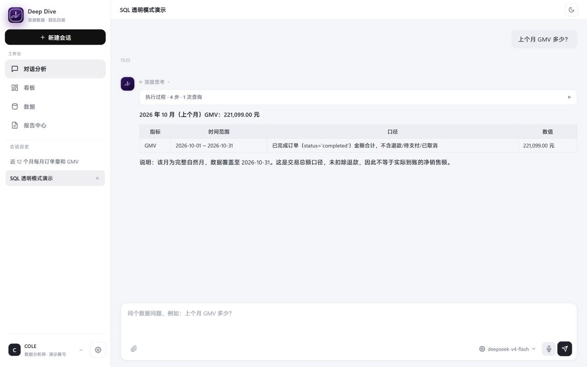
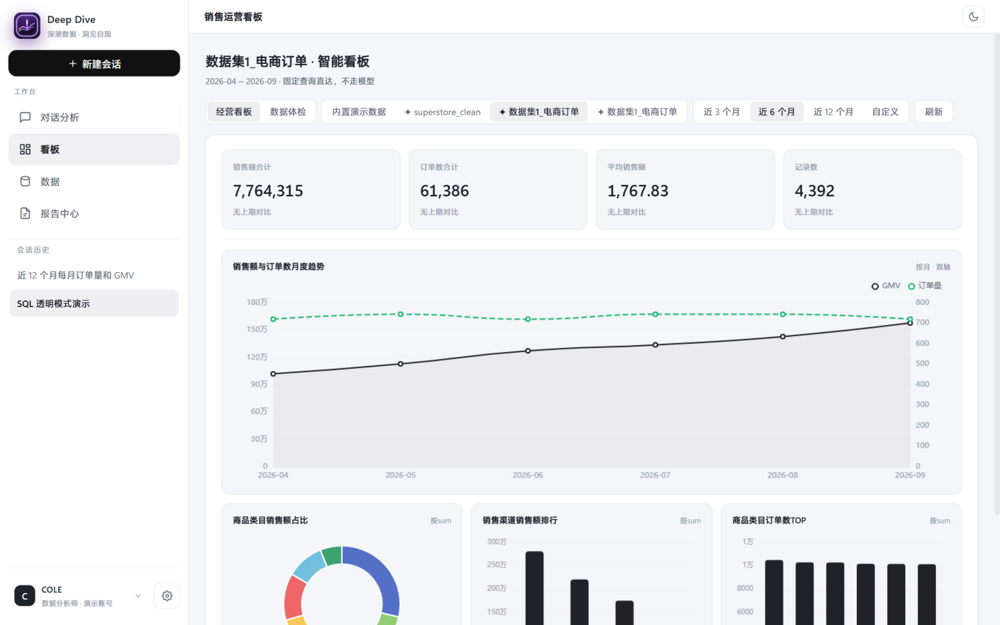
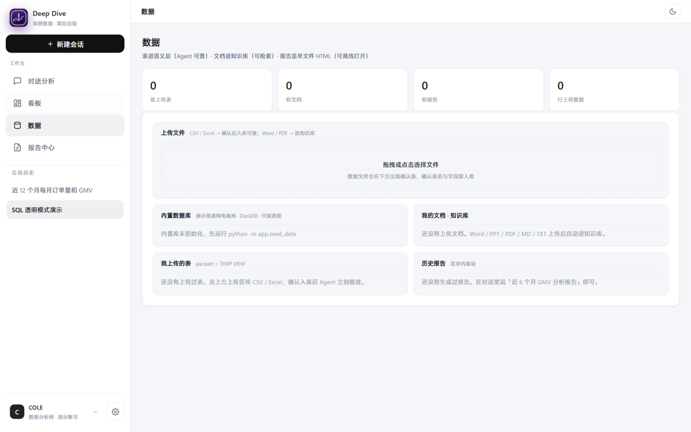
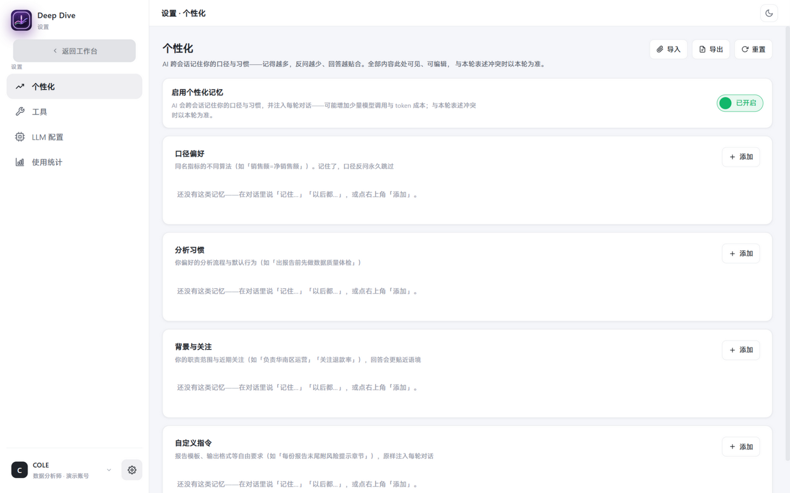

# Deep Dive Agent

[](LICENSE)


[](https://github.com/jiangweize09-create/deep-dive-agent/actions/workflows/smoke.yml)


> 深潜数据，洞见自现 —— 中文数据分析 Agent：自然语言进，真实执行的图表与结论出，**数字永远来自真实查询**。

自然语言 → 主 Agent 调度 → 语义层 → 护栏校验 SQL → 执行 → 图表与结论。

两条核心原则：**LLM 决定做什么，工作流保证不能做什么**；**工具隔离靠结构，不靠工具筛选器**——
子 Agent 只带自己那份工具；单动作能力直接做成普通工具，只给「需要多步决策」的执行者拆子图。

## 🖼️ 产品预览

| 对话分析（过程直播 · SQL 透明） | 销售运营看板（KPI · 趋势 · 数据体检） |
|---|---|
|  |  |
| **数据**（内置库说人话 · 上传表清单） | **设置 · 个性化**（记忆开关与四类记忆） |
|  |  |

> 演示录制脚本（话术 / 翻车预案 / 面试 Q&A，供录 Demo 用，非产品文档）见
> [docs/DEMO_SCRIPT.md](docs/DEMO_SCRIPT.md)。

## ⚡ 快速开始（三条路径）

**① 本地跑（推荐，最完整）**：

```bash
# Python 3.10+；装包务必 python -m pip，别用裸 pip——多解释器环境
python -m pip install -r requirements.txt
python -m app.seed_data   # 生成演示数据（12 个月电商订单，确定性随机）
python run.py             # → 打开 http://127.0.0.1:8000
```

**② Docker 联机模式**（同一局域网任何设备可访问；需 Docker Compose **v2.24+**）：

```bash
# 演示模式可直接启动，无需 .env；live 模式才复制 .env.example 为 .env 填 LLM 配置
docker compose up -d                                  # 构建并后台启动（首次 2-5 分钟）
docker compose exec deep-dive python -m app.seed_data # 首次启动生成演示数据（写入挂载的 data/）
# → 本机 http://127.0.0.1:8000；局域网设备 http://<本机IP>:8000
```

> ⚠️ **安全提示**：本项目**无鉴权**（详见 [SECURITY.md](SECURITY.md)）——绑 0.0.0.0 会向
> 局域网开放服务，仅限**可信内网**使用，禁止暴露公网。

**③ 看 Demo**：默认演示模式零配置可体验全链路与护栏；完整演示剧本见
[docs/DEMO_SCRIPT.md](docs/DEMO_SCRIPT.md)。

**切 live 模式**：界面「设置 → LLM 配置」页填任意 OpenAI 兼容端点（DeepSeek / 通义 / 智谱
GLM / Moonshot / OpenAI），或 `.env` 配 `XIHUANG_LLM_*`。API Key 存于浏览器 localStorage
或本机 .env；仅在调用时随请求转发给所选 LLM 端点，后端不落盘、不记录日志。

## ✨ 核心特性

- **护栏硬校验**：全部 SQL 过 sqlglot AST 九项检查（只读 / 数据源白名单 / 表字段白名单 /
  PII 拦截 / join 键校验 / 口径强制过滤 / 强制 LIMIT）——模型写不出能作恶的 SQL
- **确定性洞察**：趋势 / 环比 / z-score 异常 / 集中度全部代码计算，日期解析、维度值采样同理
  ——模型只组织语言，从头到尾不产生一个数字
- **方法论技能库**：10 个分析技能（SWOT / 波士顿矩阵 / 波特五力 / RFM / GMV 下滑归因 /
  大促复盘…），命中即按 SOP 取数执行；用户丢一个 md 进语料目录就能自定义技能
- **评测全绿**：46 条 Golden Set 确定性评测（判定全规则，不依赖 LLM Judge）+ 35 项冒烟自测
- **双 HITL 缰绳**：口径澄清 + 执行计划审批（全部 interrupt/resume，服务端判定不靠 prompt）
- **过程全直播**：SSE token 级流式——思考链 / 工具调用 / 子 Agent 实时思考全程可见

## 🆚 对比

| | 裸 NL2SQL 脚手架 | 传统 BI 平台 | **Deep Dive** |
|---|---|---|---|
| 数字可信 | ❌ 模型自由发挥，可编造 | ✅ 走建模查询 | ✅ 护栏 + 确定性计算，模型不产生数字 |
| 口径治理 | ❌ 无 | ✅ 完整语义层 | ✅ 语义层 YAML 即护栏白名单（唯一来源） |
| 部署形态 | ✅ 轻 | ❌ 多服务 + 中央库 | ✅ 单文件零配置，Docker 可选 |
| 可验证性 | ❌ 无评测 | ⚠️ 少 | ✅ 46 条确定性评测 + 35 项冒烟 |
| 上手成本 | 低 | 高（建模/角色/审批流） | 低（一条命令起，`run.py` 即开发即演示） |

## 🙋 什么人别用我（诚实边界）

- 要**公网部署 / 多人同时使用** —— 无鉴权设计（见 [SECURITY.md](SECURITY.md)），仅限可信内网单租户
- 要**多用户 / 权限 / 团队协作** —— 单租户设计；生产化切换点已预留，但当前明确不做
- 要 **ML 建模 / 训练预测** —— 不做，这是问数 Agent 不是数据科学工作台
- 要**严格漏斗 / 留存分析** —— 演示库没有事件表，做不了（口径限制会在回答中如实声明）
- 要**企业多角色审批流** —— 口径变更治理与版本化在路线图，当前是轻量实现

## 🗺️ 路线图

- [x] 语义层 / 薄编排主循环 / 确定性护栏 / Golden Set
- [x] 多 Agent 调度（主 + SQL / viz 子图即工具，rag_retrieve 直连）
- [x] RAG 知识库（混合检索 · embedding 双通道 · 检索评测）
- [x] viz/报告 Agent（句柄协议 · 确定性洞察 · 真代码 reflection · 离线 HTML）
- [x] 文件上传（数据草稿确认入库 · 文档入知识库 · 护栏零特判）
- [x] scipy A/B 检验；销售看板（固定 SQL）+ AI 看板（LLM 规划一次）
- [x] token 级流式（delta 打字机）+ 子 Agent 思考直播（sub_delta 快车道）
- [x] 会话记忆持久化（AsyncSqliteSaver，重启续聊）
- [x] 聊天框上传 / 语音输入 / 附件文件卡 全量迁移 React 版
- [x] 品牌焕新：观澜 → Deep Dive（墨青+金徽标）· 墨黑交互主色 · 图型扩展（散点/堆叠/分组）
- [x] 对话生成看板（generate_dashboard 工具）
- [x] reasoning 思考链外显（ReasoningChatOpenAI 透传 reasoning_content，前端深度思考折叠区）
- [x] 口径澄清 HITL + 数据范围澄清 HITL（interrupt/resume）
- [x] **计划审批 HITL**（propose_plan：复合任务先出计划，批准/修改/取消；修复 aget_state 同步调用潜伏 bug）
- [x] **语义偏好记忆**（四类记忆 · 三入口写入 · 反问只问一次 · 设置页「个性化」管理）
- [x] **产物资产化**（artifacts.db · artifact 事件 · 报告中心页 · 报告/数据源删除三同步）
- [x] **维度值样本注入**（gen_samples · 真实取值透传 search_schema，杜绝字面量心算）
- [x] **数据质量体检**（profile_table：行数/空值/分布/异常行，质量结论进回答）
- [x] **data_coverage 按需工具**（各表覆盖时间范围，0 行时按需调用替代复查三连）
- [x] **看板增强**（自定义起止日期 · 数据源删除 · 报告删除 · 图例修复）
- [x] **设置中心**（记忆/工具/LLM 三合一收进齿轮 · 主侧栏只留工作台 · 会话历史扩容）
- [x] **方法论技能库 1.0**（10 技能：SWOT / 波士顿矩阵 / 波特五力 / RFM + 6 分析 SOP，frontmatter 标准化）
- [x] **Docker 一键部署**（Dockerfile + compose · uvicorn 0.0.0.0 联机 · data/ 卷挂载）
- [ ] 技能管理页（技能列表 / 启停 / 导入校验）
- [ ] ARIMA 时序预测工具（statsmodels 内置确定性预测）
- [ ] MCP 工具接入（make_delegate_tools 追加，主图不动；先接 API 型 server，数据类 server 须只读账号）
- [ ] 证据链引用（结论数字带角标，可回查查询快照——对标 FactRef 且叠加口径快照）
- [ ] 审计日志（执行 + 拦截全留痕，管理页可查）
- [ ] 语义层版本化（口径变更有版本有 diff，快照记录当时口径）
- [ ] CI 门禁（GitHub Actions 跑冒烟 + 评测）
- [ ] SOP 流程沉淀（成功分析一键存为 SOP 入 RAG，下次同类问题自动复用）
- [ ] 上下文压缩（多轮长会话历史摘要；触发线：单轮常态 >40k 或会话 >20 轮）
- [ ] 多业务域（语义层按 domain 目录化，护栏零改动）

---

# 📚 深度文档（以下为架构与实现细节）

## 架构（主 Agent 调度 + 两个子 Agent + 直连工具组）

```
聊天界面（React + ECharts，SSE 流式：delta 打字机 + sub_delta 子 Agent 思考直播）

┌────────────────────────────────────────────────────────────────────┐
│  主 Agent（graph.py · 调度者）                                       │
│  绑 6 个工具：delegate_sql / rag_retrieve / generate_dashboard /     │
│    delegate_viz / propose_plan（计划审批 HITL）/ save_memory（偏好记忆）│
│  会话记忆：AsyncSqliteSaver（data/checkpoints.db，重启不失忆）        │
│  HITL 三种：口径澄清（clarify）· 计划审批（propose_plan）·           │
│    数据草稿确认（上传入库）——全部 interrupt/resume                    │
│  语义偏好记忆：每轮注入 note_for_prompt（data/memory.db，跨会话）      │
└────┬──────────────┬──────────────┬──────────────┬──────────────┘
     │ delegate_sql │ rag_retrieve │ generate_    │ delegate_viz(task, handle)
     │ 子图即工具    │ 普通工具      │ dashboard    │ 子图即工具 + 句柄协议
┌────▼───────────┐┌──▼───────────┐┌──▼──────────┐┌──▼──────────────────┐
│ SQL 子 Agent    ││ 知识库检索     ││ AI 看板规划   ││ viz / 报告子 Agent   │
│ 10 工具·ReAct   ││ 向量+BM25+RRF ││ LLM规划一次   ││ 4 工具·review 节点验收│
│ ≤8轮            ││ 返回片段与来源 ││ 确定性渲染    ││ 凭句柄取数，无查库能力 │
│ AST 护栏在工具内 ││              ││              ││                     │
└────┬───────────┘└──────────────┘└──────────────┘└─────────────────────┘
     │ 数据覆盖区间/维度值样本/数据质量体检：确定性事实按需给模型（工具化）
┌────▼───────────┐   ┌──────────────┐   ┌─────────────┐  ┌──────────────────┐
│ DuckDB 只读     │   │ RAG 索引      │   │ 上传注册表+  │  │ scratch.duckdb    │
│ 12 个月订单     │   │ 口径手册+技能库│   │ AI 看板 spec │  │ 临时结果表（读写）  │
└────────────────┘   └──────────────┘   └─────────────┘  └──────────────────┘
        语义层 YAML（6 表 · 7 指标）贯穿 SQL 护栏与看板；上传表动态并入同一目录
```

### 为什么检索/看板是工具而不是子 Agent

只有 1 个动作的执行者没有决策空间，包一层子图是多一次 LLM 往返的伪多 Agent。
判定标准：**需要多步决策的执行者才拆子图。**

| 执行者 | 工具数 | 需要多步决策 | 形态 |
|---|---|---|---|
| SQL | 10 | 要（检索→日期→体检→校验→重试→执行→出图） | 子 Agent |
| viz / 报告 | 4 | 要（取数→画图→组装→验收打回） | 子 Agent |
| 知识检索 / AI 看板 | 1 | 不要（查一次，给片段） | 普通工具（主 Agent） |
| 计划审批 / 记忆写入 | 1 | 不要（单动作控制面） | 普通工具（主 Agent） |

### 句柄协议：子 Agent 之间只传句柄，不传数据

报告链路两段：`delegate_sql`（查数后 `persist_result` 落 scratch 临时库，返回句柄
`h_<会话指纹>_<序号>`）→ `delegate_viz(task, handle)`（凭句柄取数加工）。控制面走委派
调用，数据面走 DuckDB——数据本身不进任何 LLM 上下文。安全边界：

- 业务库只读；**唯一写入口是 `persist_result`**，写入的是"已过全套护栏的查询结果"
- 句柄正则 + 会话指纹双重校验，跨会话句柄一律拒绝（服务端判定，不靠 prompt）
- 请求结束精确清理本次创建的临时表；报告 HTML / Excel 已落盘，不依赖临时表存活

### 流式与思考直播（token 级）

| 事件 | 内容 | 前端呈现 |
|---|---|---|
| `delta` | 主 Agent 正在生成的文字（播报/结论） | 结论区打字机 + 闪烁光标 |
| `sub_delta` | 子 Agent 正在生成的文字（实时思考） | 过程卡顶部实时思考行，步骤落地时固化 |
| `thinking/step/result` | 播报句 / 工具调用 / 结构化回执 | 过程卡步骤行，实时逐条出现 |
| `plan` | 计划审批请求（复合任务） | 计划卡：批准 / 修改 / 取消 |
| `artifact` | 产物资产登记（报告/Excel） | 消息内产物卡：打开 / 下载 |
| `clarify` | 口径澄清反问 | 澄清卡：选项即答 |

实现要点：主图 astream 双模式（updates+messages）；子 Agent 过程事件经**快车道**
（`events.subagent_queue`）实时入队，SSE 层双屏监听合并转发——委派期间从"结尾整段回放"
变成"直播"。评测器/冒烟测试消费旧的列表总线（批量语义），两通道互不干扰。

### 会话记忆持久化

`MemorySaver → AsyncSqliteSaver`：FastAPI lifespan 启动时注入（`data/checkpoints.db`
单文件，`langgraph-checkpoint-sqlite`），重启后多轮上下文与 HITL 中断点完整续上；
未安装该包或打开失败自动回退内存记忆，服务照常可用。

### 确定性洞察与真代码 reflection

- 报告的「洞察」不是 LLM 自由发挥：`report/insights.py` 纯代码算趋势/环比/z-score
  异常（|z|≥2）/集中度/缺失率，LLM 只组织语言
- viz 子图在 ReAct 外多一个 **review 节点**（纯 Python）：可绘图却没图 / 没组装报告
  就打回返工（最多 1 轮防振荡）。质量标准写在代码里而不是 prompt 里

### 三种 HITL（全部 interrupt / resume，服务端判定不靠 prompt）

| 类型 | 触发 | 形式 |
|---|---|---|
| 口径澄清 | 同名指标命中多个口径（如「销售额」） | 选项卡：选择即答，**答过的记入长期偏好，永久跳过** |
| 计划审批 | 复合分析任务（≥2 次委派） | 计划卡：批准 / 修改 / 取消；简单任务零开销不弹卡 |
| 数据草稿确认 | CSV/Excel 上传入库 | 确认面板：核对表名 + 标注时间/金额/维度列 |

评测器 `hitl=off` 直通，三种 HITL 均不阻塞无人值守运行。

### 语义偏好记忆（跨会话）

`app/memory.py` + `data/memory.db`（SQLite）：AI 越用越懂你，**反问只问一次**。

- 四类记忆：口径偏好（销售额=净销售额）· 分析习惯（出报告前先做数据质量体检）·
  背景与关注（负责华南区运营）· 自定义指令（每份报告末尾附风险提示章节）
- 三个写入入口，全部可溯源：口径卡明确选择（`hitl`）· 对话里说「记住/以后都…」
  （主 Agent 调 `save_memory` 工具）· 设置页手动增改（`manual`）
- 每轮把记忆编译成紧凑 SystemMessage 注入主 Agent；已记住的口径并入 clarify 的
  已确认集合——同一术语永远不再反问
- 设置页「个性化」：四类分区可见、可编辑、可导入/导出 JSON、可一键重置——
  透明可控，不搞黑箱；与用户本轮表述冲突时以本轮为准

### 产物资产化与报告中心

`app/artifacts.py` + `data/artifacts.db`（SQLite）：报告/Excel 不再只活在聊天文本里。

- 报告生成即登记（会话绑定 + 标题 + url + excel_url + 图表/洞察数），live 与 demo 两条路都覆盖
- SSE 新增 `artifact` 事件 → 聊天里渲染结构化产物卡（打开报告 / 下载 Excel）
- 侧栏「报告中心」页：跨会话翻阅全部产物，搜索、按会话跳转、删除（文件 + 登记三同步）
- 服务重启 / 换浏览器后报告入口不丢；数据页历史报告同样可删

### 确定性事实按需给模型：维度值样本 · 覆盖区间 · 质量体检

与 `resolve_date_range`（杜绝日期心算）同一哲学的三块拼图——**能确定性给到的事实，
就不要让模型猜**：

- **维度值样本注入**（`semantic/samples.py` + `python -m app.gen_samples`）：把每张表
  低基数文本列的真实高频取值写入 `data/samples.json`，`search_schema` 透传给 LLM——
  杜绝「华东」vs「华东大区」式字面量翻车。播种后自动跑、上传入库自动采、删除同步清
- **`data_coverage` 按需工具**（第 10 个工具）：各表实际数据的时间范围。**做成工具而非
  常驻注入**——预注入是快照，活库进新数据/模糊日期时会过时误导；按需调用那一刻现算，
  永远新鲜。查询 0 行时先看覆盖再决定重查或说明，替代原来的「复查三连」（实测该场景
  省 60% token），正常查询零开销
- **`profile_table` 数据质量体检**（第 9 个工具）：行数/空值率/数值分布/异常行（|z|≥3）+
  确定性质量提示。深入分析前先验货，质量结论写进回答（「该列缺失率 30%，结论仅供参考」）。
  表名走语义层白名单、PII 列完全不碰

## 开发与构建

```bash
# （可选）改 React 前端后重建（产物直接进 frontend/dist，服务优先返回它）
cd web && npm install && npm run build

# （可选）手动重算维度值样本（上传表入库时自动采，平时无需）
python -m app.gen_samples
```

**前端入口**：`frontend/dist/`（React 构建产物，唯一入口；未构建时首页返回构建指引）。
改前端必须 `npm run build` 并**提交 dist**——保证 clone 下来零构建可跑。

## 两种运行模式

| | 演示模式（默认） | live 模式 |
|---|---|---|
| LLM 决策 | 内置脚本场景 | 真实 LLM（function calling） |
| SQL 校验/执行/图表/检索 | **真实运行** | **真实运行** |
| token 流式（delta/sub_delta） | 无（无真实 token） | 有 |
| 用途 | 零配置体验全链路与护栏 | 任意自然语言问题 |

## RAG 知识库与技能库（`app/rag/`）

语料 = 指标口径手册（与 metrics.yaml 同源）+ 10 个方法论技能（SWOT / 波士顿矩阵 /
波特五力 / RFM / A/B 实验 / GMV 下滑归因 / 大促复盘 / 新用户转化 / 退款异常排查 /
渠道分析，带 frontmatter 技能头）+ 用户上传文档。Markdown 按标题切分（~500 字 /
80 重叠）。**混合检索**：中文业务术语靠 BM25 精确词匹配兜底，同义改述靠向量泛化，
两路 top-20 用 **RRF** 融合取 top-5。embedding 双通道：配置 `XIHUANG_RAG_EMBEDDING_*`
走 OpenAI 兼容 /embeddings，否则本地确定性哈希（256 维）零配置可用。

技能包格式：一个技能 = 一个 md（内置放 `app/rag/corpus/`，用户上传入 `data/corpus_user/`），
frontmatter 声明触发词 / 适用场景 / 数据提示 / 输出模板——技能只是知识，永远绕不过
代码层护栏。规模化切换点：`store.py` JSON+余弦 → Chroma/pgvector，`retrieve.py`
接口不变。

## 文件上传（聊天框回形针 / 数据页，两条路线）

| 类型 | 路线 | 结果 |
|---|---|---|
| CSV / Excel | 语义层：类型推断 → PII 标记 → **草稿确认面板**（白话问句标注时间/金额/维度列）→ parquet+TEMP VIEW 入库 | Agent 立即可查（`up_*`）；**入库即自动采集维度值样本**；附件以文件卡挂在消息气泡上方 |
| Word / PPT / PDF / MD / TXT | 知识库：文本提取（docx 含表格 / pdf 文字版≤120 页）→ 用户语料 → 索引重建 | rag_retrieve 立即可检索引用 |

护栏零特判：上传表进同一份语义层目录，未知表/PII/强制 LIMIT 自动生效。上传确认后
**AI 看板后台自动生成**；数据源歧义（"这个数据…"）由 HITL 反问澄清。

## AI 看板（`dash_spec.py` + `dashboard.py`）

**LLM 规划一次，确定性渲染一万次**：上传入库后 LLM 读列结构+样本值输出看板 spec
（KPI 2~4 + 图表 1~4），白名单校验（聚合 6 种 / 图型 7 种）写进注册表，之后每次渲染
都是确定性 SQL——秒开、零 token、可复现。图型词汇表：

| 图型 | 用途 |
|---|---|
| trend | 按月金额+笔数双轴趋势 |
| pie / bar / top | 单维度占比 / 排行 / TOP 榜 |
| **scatter** | 两数值列相关性散点（采样 500 点） |
| **stack / group** | 双维度交叉：横轴=主维度 TOP8，系列=次维度 TOP5（堆叠 / 并排） |

入口三个：上传确认后自动生成 / 看板页点未就绪数据源就地生成 / **对话里说"给
up_xxx 生成看板"**（主 Agent 的 generate_dashboard 工具）。不缺时间列/数值列的表会被
LLM 判 `unsuitable` 并给出建议。看板页数据源 = 内置演示 + 全部上传表，失效自动回退内置。

**看板管理**：预设时间范围（近 3/6/12 个月）+ **自定义起止日期**（任意跨度，止日含当天，
上期环比自动等长对齐）；上传数据源悬停出删除角标（连表带看板配置一并删，内置源不可删）。

## 前端信息架构

主侧栏只放工作台四页：**对话分析 · 看板 · 数据 · 报告中心**；会话历史占据侧栏最大弹性区。
设置类三页（个性化 / 工具 / LLM 配置）收进左下角齿轮 → 「设置」页三合一标签。
主题切换在顶栏右上角；输入框自动增高（112~280px）。

## 工具清单

**SQL 子 Agent（10 个）**：`search_metrics` · `search_schema`（透传维度值样本）·
`resolve_date_range`（时间词→确定区间，杜绝模型心算日期）· `profile_table`（数据质量
体检）· `validate_sql` · `run_sql`（执行前重过护栏）· `generate_chart` ·
`persist_result`（白名单落表返句柄）· `ab_test`（scipy 确定性 p 值/置信区间）·
`data_coverage`（各表实际数据时间范围，0 行时按需调用）

**viz/报告子 Agent（4 个，凭句柄无查库能力）**：`fetch_data`（含确定性洞察）·
`render_chart` · `export_excel` · `build_report`（单文件 HTML，echarts 内嵌可离线打开）

**主 Agent 直连普通工具（4 个）**：`rag_retrieve`（混合检索）· `generate_dashboard`
（AI 看板）· `propose_plan`（计划审批 HITL，复合任务先出计划）· `save_memory`（长期
偏好写入）

## 护栏清单（全部在 `run_sql` / `validate_sql` 内部）

- 连接层：DuckDB **read_only** 打开
- AST 层：sqlglot 解析，仅放行 SELECT/UNION
- **数据来源白名单**：FROM/JOIN 只允许语义层登记的表/子查询/VALUES，拒绝
  `read_csv`/`glob`/`generate_series`/UNNEST 等表函数（防任意本地文件读入）
- 禁止 `SELECT *`；未知表/未知字段拦截（逼 LLM 先走语义层检索）
- **PII 字段拦截**（users.phone/email，含别名/CTE 改名/UNION 别名碰撞）
- join 连通性 + **join 键校验**（只允许声明过的键，笛卡尔积拒绝）
- **指标口径强制**（required_filters：命中指标聚合形状却无状态过滤即拦）
- 强制 `LIMIT 1000`（含 `LIMIT 5+5`/`LIMIT ALL` 非字面量改写）
- 预算：子 Agent 单轮 ≤8 次工具调用；主 Agent ≤3 次委派
- **写路径白名单**：全系统唯一写入口 `persist_result`，业务库只读不变

## 语音输入（可选）

输入框麦克风：点击开始 / 再点停止识别，识别文字追加进输入框。后端 `POST /api/asr`
走阿里百炼 Paraformer-v2（OpenAI 兼容转写）；`.env` 配 `XIHUANG_ASR_API_KEY` 启用，
未配置优雅降级提示。浏览器 `MediaRecorder` 自动选容器（webm/opus 或 mp4），
到 `XIHUANG_ASR_MAX_SECONDS`（默认 60s）自动停止。

## 项目结构

```
deep-dive-agent/  # 仓库名与本地目录同名
├── app/
│   ├── main.py            # FastAPI + SSE（delta/sub_delta 双流 + 快车道合并循环）+ lifespan 持久记忆
│   ├── config.py / db.py / seed_data.py / workspace.py / datasources.py
│   ├── memory.py          # 语义偏好记忆：SQLite + 注入提示 + save_memory 工具（跨会话）
│   ├── artifacts.py       # 产物资产库：报告/Excel 登记（SQLite）+ 报告删除三同步
│   ├── gen_samples.py     # 维度值样本注入 CLI（python -m app.gen_samples）
│   ├── asr.py             # 语音转写（百炼 Paraformer-v2）
│   ├── uploads.py         # 文件上传：CSV/Excel 入库（parquet+TEMP VIEW）· 文档入 RAG · 自动采样
│   ├── dashboard.py       # 看板渲染：内置白名单 SQL + 上传表模板 + AI spec 确定性渲染（7 图型）
│   ├── dash_spec.py       # AI 看板规划：LLM 读 schema 出 spec，白名单校验写注册表
│   ├── semantic/          # tables.yaml · metrics.yaml · loader · samples（维度值样本）· coverage（覆盖区间）
│   ├── rag/               # corpus/（含技能库）· ingest · embeddings 双通道 · store · retrieve（向量+BM25+RRF）
│   ├── report/            # insights 确定性洞察 · store · excel · assemble 单文件 HTML · tools
│   ├── agent/
│   │   ├── graph.py       # 主 Agent（调度者 + clarify/propose_plan 双 HITL + save_memory + SqliteSaver）
│   │   ├── sql_agent.py   # SQL 子 Agent + delegate_sql + rag_retrieve + generate_dashboard
│   │   ├── viz_agent.py   # viz/报告子 Agent + delegate_viz（review 真代码反思边 + 产物登记）
│   │   ├── clarify.py     # 口径歧义 + 数据范围歧义 + record_caliber_choice（选择即记忆）
│   │   ├── events.py      # 请求级双通道：列表总线（评测）+ 快车道 queue（live 直播）
│   │   ├── messages.py    # 子 Agent 共用消息工具
│   │   └── prompts.py     # ROUTER(15 条纪律) · SQL_AGENT · VIZ_AGENT 提示词
│   ├── tools/             # SQL 子 Agent 10 工具（含 scratch.py 句柄协议 · profile.py · data_coverage.py）
│   ├── guardrails/        # sqlglot AST 护栏（PII/join键/口径/LIMIT/来源白名单）
│   ├── demo/              # 演示模式脚本轨迹（6 场景，真实执行与检索）
│   └── eval/              # Golden Set（46 条）+ 检索评测
├── web/                   # React 18 + TS 前端源码（Vite，outDir → frontend/dist）
│   └── src/pages/         # Chat · Dashboard · Data · ArtifactsPage(报告中心) · SettingsPage(三合一) · Tools · Llm · Memory
├── frontend/              # dist/（React 构建产物，唯一入口）
│   └── vendor/            # echarts.min.js（报告 HTML 内嵌用）
├── tests/smoke.py         # 冒烟自测 35 项（纯本地可重复运行）
├── docs/                  # 演示脚本 · 产品截图 · 代码讲解（历史归档版）
├── .github/workflows/smoke.yml   # CI：push / PR 自动跑冒烟
├── SECURITY.md            # 安全边界与部署须知（部署前必读）
├── Dockerfile / docker-compose.yml   # Docker 联机部署（见快速开始路径②）
└── run.py
```

**运行时数据文件**（均在 `data/`，gitignore）：`xihuang.duckdb`（业务库）·
`samples.json`（维度值样本）· `memory.db`（偏好记忆）· `artifacts.db`（产物登记）·
`scratch.duckdb`（句柄临时库）· `checkpoints.db`（会话记忆）· `reports/`（报告文件）。

**命名说明**：`XIHUANG_*` 环境变量、`xihuang.duckdb` 等为项目早期代号的历史兼容前缀
（保持向后兼容），与当前品牌 Deep Dive 无关。

## 评测

```bash
python -m app.eval.runner        # 未配 live 自动只跑 retrieval 条目
# live 全量：SQL 类条目走真实 LLM
XIHUANG_LLM_BASE_URL=... XIHUANG_LLM_API_KEY=... XIHUANG_LLM_MODEL=... python -m app.eval.runner
```

Golden Set 46 条（simple/join/metric/time/fuzzy/multi/deny/retrieval），判定全用确定性
规则（SQL 执行比对 / deny 零 PII 泄露 / retrieval top-3 命中），不依赖 LLM Judge。
live 实测多次全绿；live 模型存在 ±10% 措辞/步数抖动，单条偶发未命中以重跑为准。

## 生产化切换点（骨架 -> 生产）

| 项 | 当前 | 切换到 |
|---|---|---|
| 数据库 | DuckDB 只读（零配置演示） | Postgres 只读账号 + RLS |
| 会话记忆 | ~~MemorySaver~~ **AsyncSqliteSaver（已完成）** | Postgres checkpointer（多副本） |
| 偏好记忆 | SQLite（data/memory.db，已完成） | Postgres / 向量库 |
| 产物登记 | SQLite（data/artifacts.db，已完成） | 对象存储 + 元数据落库 |
| RAG 向量化 | 本地哈希 / API 双通道 | API 向量化 + Chroma/pgvector |
| 前端 | ~~原生 JS~~ **React 18 + TS（已完成）** | 组件库沉淀 + 代码分割 |
| 流式 | delta/sub_delta token 直播 + reasoning 外显（已完成） | — |
| Trace | 前端过程卡片 | Phoenix / LangSmith 接入 stream_mode |
| 评测 | 46 条 Golden Set | badcase 归因闭环 + CI 门禁 |
| 工具生态 | 内置工具 + make_delegate_tools 扩展点 | MCP 工具热注册 |
